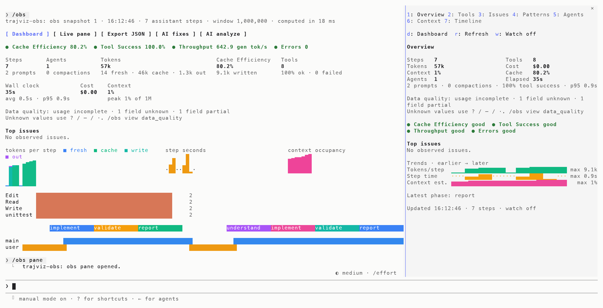
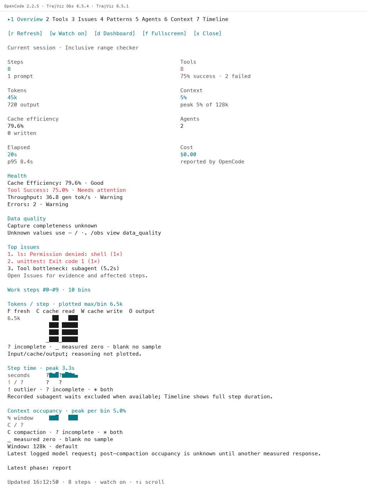
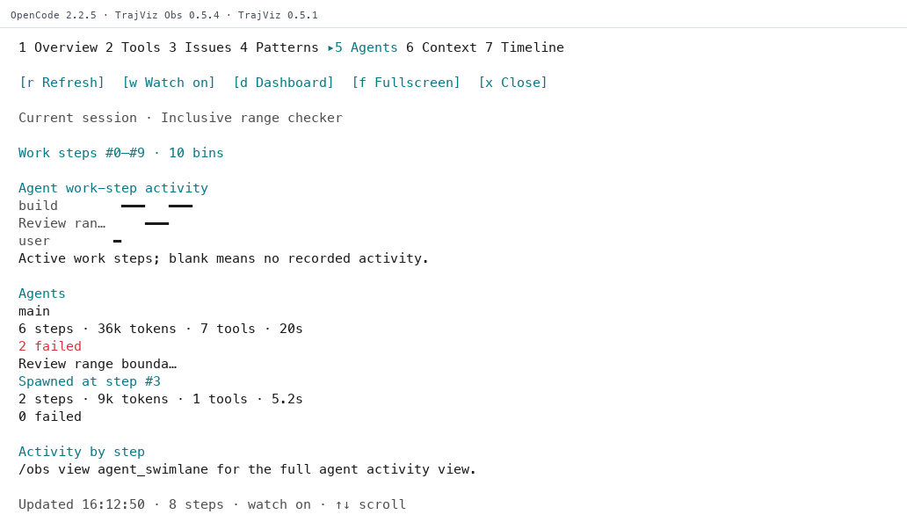
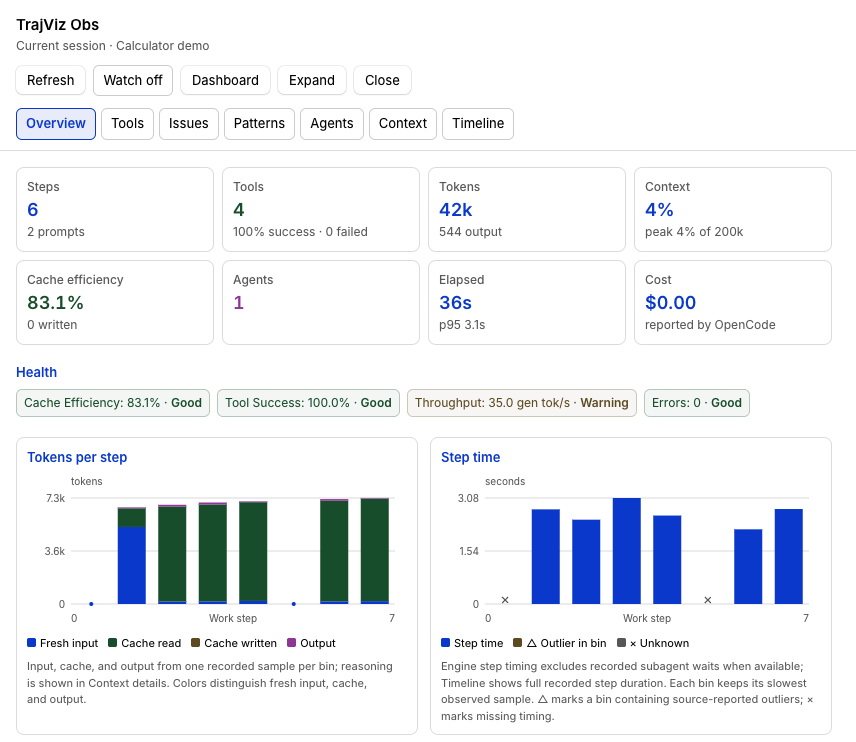
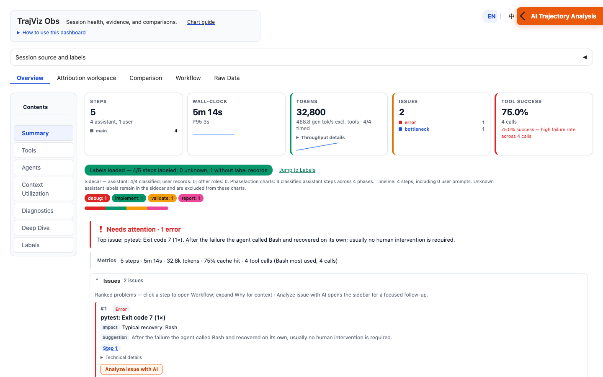
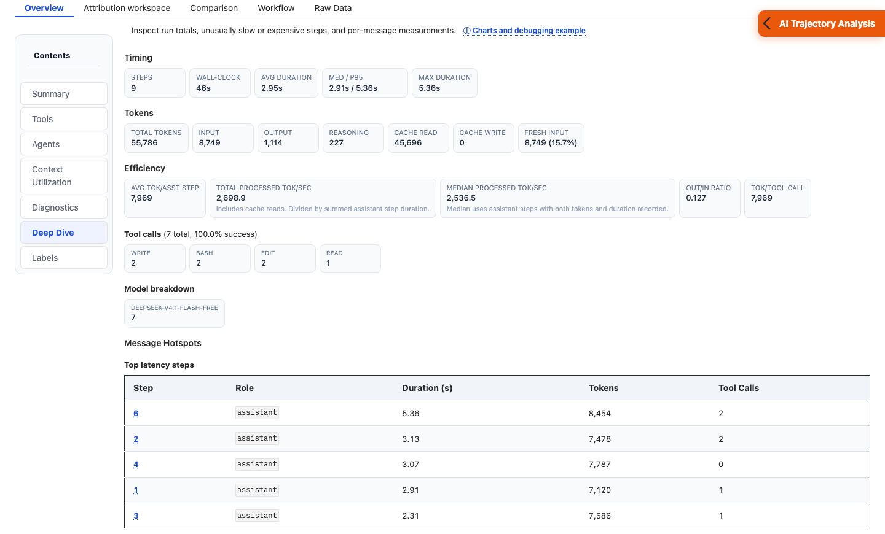

# TrajViz Obs

[](https://github.com/rshu/TrajViz-Obs/actions/workflows/checks.yml)
[](#install)
[](opencode/README.md#install)
[](https://github.com/rshu/TrajViz-Obs/blob/main/.claude-plugin/plugin.json)
[](https://github.com/rshu/TrajViz-Obs/blob/main/opencode/package.json)
[](LICENSE)

Visualize and diagnose Claude Code and OpenCode 2 sessions with [TrajViz](https://github.com/rshu/TrajViz). Use `/obs` for a quick health check and `/obs dashboard` to inspect steps, tools, subagents, and context use.

## Install

For **OpenCode 2 terminal or Desktop**, follow the [OpenCode installation guide](opencode/README.md). The instructions below install the Claude Code plugin.

Requires Claude Code with function hooks (mods) and process execution, plus [uv](https://docs.astral.sh/uv/) or **Python 3.11+ with `venv` and `pip`**. Validated on Claude Code **2.1.311**.

In Claude Code:

```text
/plugin install trajviz-obs --marketplace rshu/TrajViz-Obs
```

Confirm the marketplace and installation scope, then restart Claude Code. The first `/obs` installs a private TrajViz runtime; dashboards add their dependencies when first opened. Initial setup requires network access.

To update:

```sh
claude plugin marketplace update trajviz-obs
claude plugin update trajviz-obs@trajviz-obs
```

Run the update from the project where you use the plugin. It selects that project's most specific installation; add `--scope user`, `--scope project`, or `--scope local` to choose explicitly. Restart Claude Code after updating.

## Use

After the session's first assistant response:

```text
/obs
/obs dashboard
```

| Task | Command |
| --- | --- |
| Inspect diagnostics | `/obs issues`, `/obs agents`, `/obs view` |
| Inspect recorded workflow evidence | `/obs attribution` |
| Open a live pane | `/obs pane`; close with `/obs pane close` |
| Export data | `/obs json`, `/obs bundle`, `/obs dashboard --html session.html` |
| Compare runs | `/obs compare <session-id>`, `/obs converge` |
| Ask for analysis or fixes | `/obs analyze [question]`, `/obs fixes` |
| Label steps by phase and action | `/obs label --max-steps 20` |
| List all commands and options | `/obs help` |

Find saved sessions with `/obs sessions 20`, then add `--session <id|prefix|path>` to a session command. Run `/obs` without a selector to return to the current session.

Both plugins use TrajViz **0.5.1** and expose all **36 views**. `/obs view data_quality` explains missing or partial evidence. The dashboard distinguishes recorded zeros from missing or partial data.

Watch refreshes an open pane after turns. `/obs statusline on` pins a summary under the prompt. Use `/obs watch off` and `/obs statusline off` to stop automatic refreshes.

<details>
<summary>Saved imports and exports</summary>

Imports include CodeAgent session exports, OpenCode Desktop and Windows exports, Codex, Pi, and compressed DeepSeek sessions. JSON view exports use schema version **2**.

Saved OTLP captures can contain several sessions. List them with `/obs sessions --session /path/to/capture`, then select one with `/obs --session /path/to/capture --session-id <id>`. JSON, JSONL, bundle manifests, directories, and ZIP captures are supported. This imports saved telemetry; it does not enable live telemetry collection.

`/obs json` exports the selected session as a reloadable `trajectory.json` alongside its views. Use `--views-only` with a fresh output directory to omit the trajectory. `/obs bundle` preserves a complete OTLP capture, including its other sessions.

</details>

### Browser dashboard

- **Overview → Summary** shows health, issues, and issue JSON export. Open **Chart guide** for examples. Click a token bar for its breakdown or a duration bar to jump to the step. Use **True wall-clock** below the execution timeline to include idle time.
- **Overview → Deep Dive** shows timing, token, efficiency, tool, and model metrics. Click a step number in the latency, token-load, lowest cache-read, context-growth, or Per-Message Diagnostics tables to open it in **Workflow**.
- **Workflow** offers **Cards** for scanning and **Expanded** for full step content.

The selected session and cached labels load automatically. Run `/obs dashboard stop` when done. In OpenCode, use the stop command shown when the dashboard starts to target a saved session.

## Demo

Terminal images are rendered from recorded output. The dashboard Summary uses a demo fixture with a ranked issue. The other images use controlled coding sessions.

**Claude Code: overview and live pane**



**OpenCode 2 terminal: live overview**



**OpenCode 2 terminal: subagent activity**



**OpenCode Desktop: metrics and charts**



**Browser dashboard: Summary**



**Browser dashboard: Deep Dive**



## Configure

In Claude Code, use `/plugin configure trajviz-obs@trajviz-obs` or `/config` for plugin options. Model features default to `llm=session`, using Claude Code's client: `analysisModel=sonnet` for analysis and fixes, and `labelModel=haiku` for labeling. Set either model option to `session` to follow the main conversation's model.

OpenCode uses [options in its configuration file](opencode/README.md#options) and defaults to its selected model.

Run `/obs dashboard port` to see the default port or `/obs dashboard port 7863` to save a new one during a session. The change applies the next time you run `/obs dashboard`. Use `auto` for automatic selection or `default` to restore the `dashboardPort` plugin option (`0` means automatic). `/obs dashboard --port N` overrides the default for one launch.

<details>
<summary>Use an external model provider</summary>

Set `llm=env` and add these values to the host/server launch environment or the project's `.env`. Existing launch values take precedence; `.env` loading applies to `ANALYZE_*` and `LABEL_*` settings:

```dotenv
ANALYZE_BASE_URL=https://provider.example/v1
ANALYZE_API_KEY=your-api-key
ANALYZE_MODEL=your-model
```

Labeling uses `LABEL_BASE_URL`, `LABEL_API_KEY`, and `LABEL_MODEL`, falling back to the analysis settings. Set `ANALYZE_PROVIDER` or `LABEL_PROVIDER` to `openai` (default) or `anthropic` to match the endpoint. In this mode, the environment model settings replace `analysisModel` and `labelModel`.

</details>

<details>
<summary>Inspection and attribution</summary>

`/obs attribution` inspects recorded findings, file and test activity, and recovery evidence without reference data or model calls. For a reference-based failure diagnosis, use `/obs attribution --reference-root /path/to/reference-data`, adding `--agent NAME` and `--instance ID` when needed. The reference data must include the task's reference patch and test outcome; the dashboard also provides reference overrides.

To use a default reference folder, set `TRAJVIZ_REFERENCE_ROOT` before starting the host/server, then pass `--agent NAME` or `--instance ID` to select reference diagnosis. Verdicts require the matching canonical session; missing reference evidence produces an explanation instead of capability blame.

The **Attribution workspace** opens saved results, evidence graphs, and reports. Its evaluation settings and operations run only when explicitly selected. For OpenCode subagent reference diagnoses, use `/obs attribution` with matching reference options.

</details>

## Data and model use

Overview, diagnostic views, and exports run locally without model calls. `/obs analyze`, `/obs fixes`, and `/obs label` send redacted prompts to a model and may incur usage charges. They show a call plan first; interactive sessions ask before more than four calls. Labeling defaults to at most 50 steps.

In the live `/obs dashboard`, go to **Overview → Summary → Issues** and choose **Analyze issue with AI** on a finding to send a focused question to the analysis panel. Saved HTML exports are for offline review.

The dashboard's AI analysis panel has its own **Settings**, independently of `llm`. Environment values provide defaults. Keys stay in the current dashboard session, and remembered details exclude keys. Choose **Analyze trajectory** for a full review or enter your own question. Opening the panel makes no model call. **Test API key** sends a small request without trajectory data.

Exports and cached analysis contain session data and stay on the host unless shared. Plugin dashboards bind to `127.0.0.1` and stop on request or plugin unload. For an authenticated remote dashboard, use the standalone TrajViz CLI with `TRAJVIZ_AUTH` and upload an exported trajectory. [Standalone dashboard options](https://github.com/rshu/TrajViz/tree/v0.5.1#dashboard-and-cli)

### Usage telemetry

Usage telemetry is off by default. In Claude Code or OpenCode, run `/obs enable_telemetry` to opt in, `/obs disable_telemetry` to stop recording and pause queued uploads, and `/obs telemetry` to check delivery. The choice persists locally and takes precedence over the launch-time opt-in. On a shared OpenCode server, the choice applies to that server.

Run `/obs telemetry_destination` to see the collector. Change it during a session with `/obs telemetry_destination https://telemetry.example.com` or `/obs telemetry_destination https://127.0.0.1`. The command adds `/v1/events` to a base URL. Use `default` to restore `TRAJVIZ_OBS_TELEMETRY_URL` or the loopback default at port 8765. Changing the destination preserves consent. Each collector endpoint has its own queue and installation ID.

For an authenticated collector, supply its token as `TRAJVIZ_OBS_TELEMETRY_TOKEN` in the host’s launch environment. In Claude Code, append `--use-launch-token` to associate the token with a new destination. In OpenCode, the server sends its launch token only to the exact endpoint configured in `TRAJVIZ_OBS_TELEMETRY_URL`. To change that endpoint, update the server’s launch environment, restart the server, and run `/obs telemetry_destination default` if a saved destination overrides it. Remote collectors require HTTPS. For local HTTP on a custom port, use a URL such as `http://127.0.0.1:8765`. Reopen dashboards that were started before telemetry was enabled to track browser actions.

The sender reports allowlisted feature names, outcomes, coarse timing, and a random installation ID. Prompts, transcripts, paths, and command arguments stay on the host. Collector and HTML reporting development is tracked on `codex/telemetry-service`.

## Troubleshooting and limits

Run `/obs doctor` to check setup or `/obs setup` to install dependencies. If `/obs` is missing, check the Claude Code debug log for disabled function hooks or an API mismatch. If the dashboard is empty, export `/obs bundle` and load its ZIP manually. Over SSH, forward the displayed port; set `openBrowser=false` to disable browser opening.

- Timing is estimated from transcripts; workflow-spawned work and subagent finish times may be incomplete.
- Operation-based OTLP captures support observed metrics and inspection; transcript alignment and reference-based capability diagnosis require supported native transcripts.
- Imported sessions require manual refresh after their inputs change. Claude Code files above **32 MiB** also require manual refresh. OpenCode has [live-capture limits](opencode/README.md#options). Insight analyzes at most the first **2,000 steps**. The `trajectory.json` export retains the full parsed trajectory.
- Real-session validation covers **macOS**. Linux and Windows still need platform-specific end-to-end testing.

## Development

```sh
git clone https://github.com/rshu/TrajViz-Obs.git
cd TrajViz-Obs
claude --plugin-dir .
```

Load the local plugin once to generate Claude Code's API declarations. The following development checks require uv, Node.js, and TypeScript 5.4+:

```sh
uv sync --project bridge --locked --extra dev
bridge/.venv/bin/python scripts/check.py
```

These checks make no external model calls. For real-session testing, see `python3 scripts/e2e.py --help`; it uses your Claude Code account and incurs model usage. Keep test output outside the repository.

MIT licensed. TrajViz is a separate MIT-licensed project; this plugin is not an Anthropic product.
