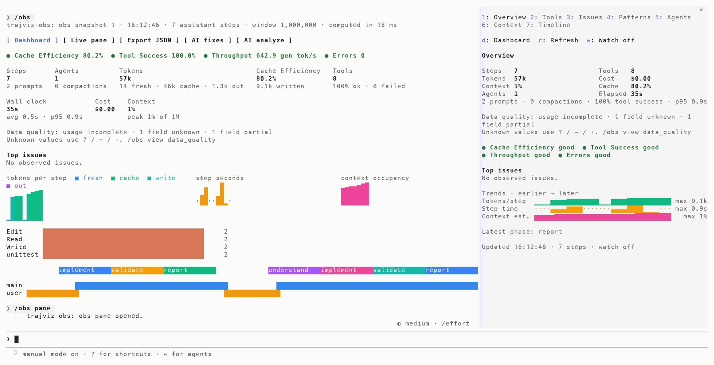
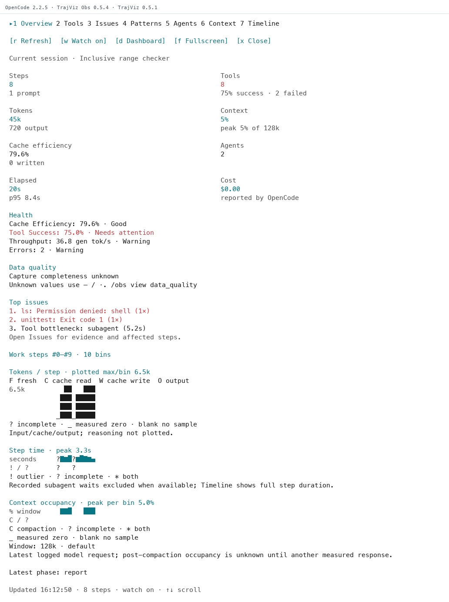
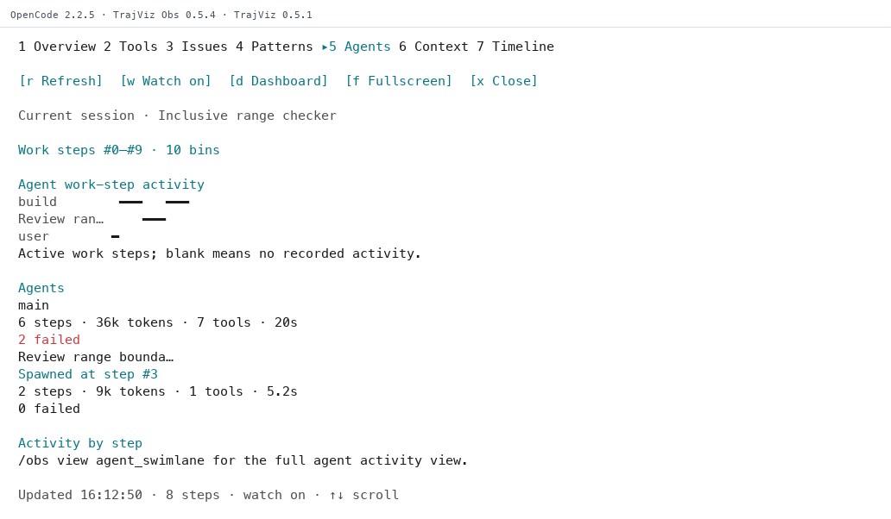
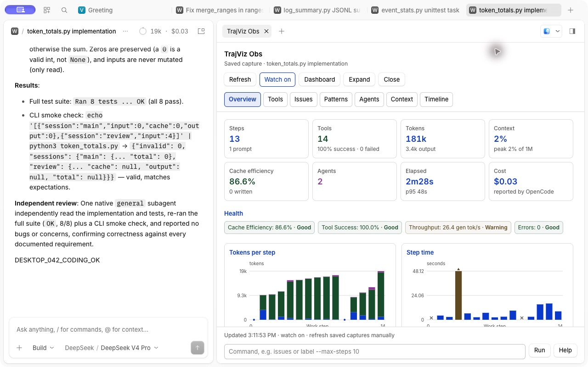
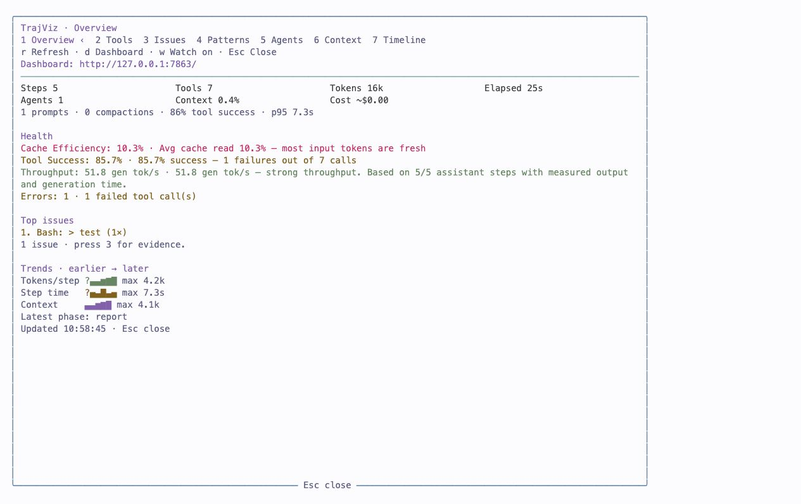
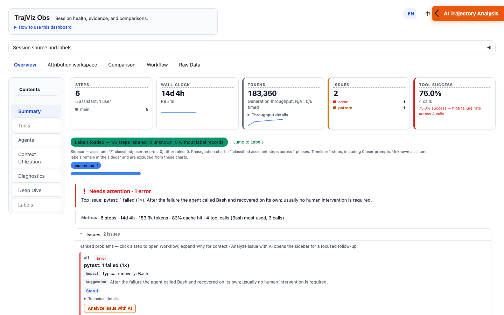
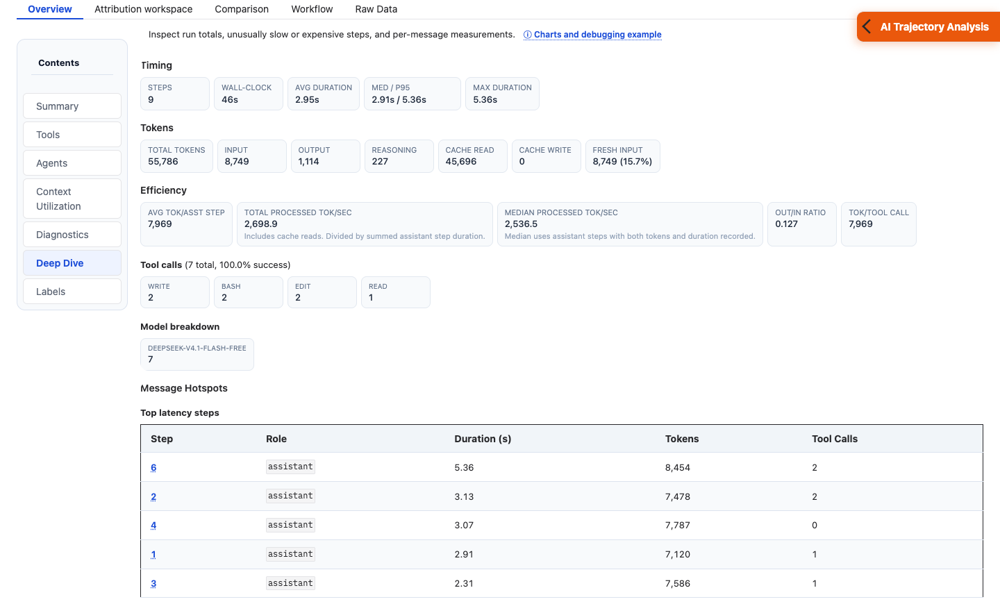

# TrajViz Obs

[](https://github.com/rshu/TrajViz-Obs/actions/workflows/checks.yml)
[](#claude-code)
[](#pi)
[](#opencode-2-terminal-and-desktop)
[](#deveco-code-experimental)
[](https://github.com/rshu/TrajViz-Obs/blob/main/.claude-plugin/plugin.json)
[](https://github.com/rshu/TrajViz-Obs/blob/main/opencode/package.json)
[](https://github.com/rshu/TrajViz-Obs/blob/main/pi/package.json)
[](LICENSE)

Visualize and diagnose Claude Code, OpenCode 2, Pi, and DevEco Code sessions with [TrajViz](https://github.com/rshu/TrajViz). Use `/obs` to check session health and `/obs dashboard` to inspect steps, tools, subagents, and context use; the experimental DevEco adapter exposes these diagnostics through its `obs` agent tool.

## Install

All adapters require [uv](https://docs.astral.sh/uv/) or **Python 3.11+ with `venv` and `pip`**. The first diagnostic command prepares a private TrajViz runtime; `/obs dashboard` adds its dashboard dependencies automatically. First-time setup requires network access.

### Claude Code

Requires Claude Code with [mods](https://code.claude.com/docs/en/plugins/mods/overview) and process execution. Validated on **2.1.311**.

In Claude Code:

```text
/plugin install trajviz-obs --marketplace rshu/TrajViz-Obs
```

Confirm the marketplace and installation scope, then restart Claude Code or run `/reload-plugins`. Run `/obs help` to verify the plugin loaded.

### OpenCode 2 terminal and Desktop

Requires [OpenCode 2](https://opencode.ai/docs/), Git, and [Bun](https://bun.sh) **1.3.0+**. Tested on terminal **2.2.5** and Desktop **2.3.2** on macOS.

Build the adapter:

```sh
git clone https://github.com/rshu/TrajViz-Obs.git
cd TrajViz-Obs/opencode
bun install --frozen-lockfile
bun run build
pwd
```

Add the adapter to `~/.config/opencode/opencode.json` on macOS/Linux, replacing the example path below with the absolute path printed by `pwd`. Create the directory and file if needed; edit an existing `opencode.jsonc` instead if present. Preserve other settings and append to an existing `plugins` array:

```json
{
  "$schema": "https://opencode.ai/config.json",
  "plugins": ["/absolute/path/TrajViz-Obs/opencode"]
}
```

Keep the checkout in place. Restart the interface you use:

- **Terminal:** close the TUI, run `opencode service restart`, then run `opencode` from your project.
- **Desktop:** quit (**Cmd+Q** on macOS), restart its managed server with `"/Applications/OpenCode.app/Contents/Resources/opencode-cli" service restart`, then reopen. Enable **trajviz-obs** in **Settings → Extensions → Plugins** on the built-in local server. Use the matching Desktop CLI and the server's original launch environment; quitting the app alone can leave its server running.

Run `/obs help` to verify installation. See the [OpenCode guide](opencode/README.md) for custom config paths, project-only installs, standalone and remote servers, updates, and removal.

### DevEco Code (experimental)

A separate adapter targets the legacy plugin interface shipped with **DevEco Code 0.2.6**. Build it with Bun **1.3.0+**:

```sh
cd /absolute/path/TrajViz-Obs/deveco
bun install --frozen-lockfile
bun run build
```

Append its built entry to the singular `plugin` array in `~/.config/deveco/deveco.jsonc`, preserving existing settings:

```jsonc
{
  "plugin": ["/absolute/path/TrajViz-Obs/deveco/dist/index.js"]
}
```

Restart DevEco Code, complete a response, and ask it to **call the `obs` tool with command `dashboard`**. Open the returned local URL for trajectory diagnostics and Prompt Evolution. This adapter does not register native `/obs` commands or panes. Its optional Captured components tab shows independent component observations without inferred request links or automatic deltas.

A separate [complete HTTP request capture opt-in](deveco/README.md#capture-complete-provider-requests) records the serialized provider body and feeds Prompt Evolution for the host-selected native session. Native trace ancestry and the matching processor identity log provide a step link only after native assistant ownership is verified. Pending requests and title/auxiliary requests remain unlinked. See the [DevEco Code guide](deveco/README.md) for setup, commands, capture boundaries, and limitations.

### Pi

Requires [Pi](https://pi.dev/), **Node.js 22.19+**, npm, and Git. Tested on **Pi 1.5.2 and 1.6.0**. Install the plugin for your user account, then start Pi in the project you want to observe:

```sh
pi install git:github.com/rshu/TrajViz-Obs
cd /path/to/project
pi
```

If Pi is already running, restart it or run `/reload`. Run `/obs help` to verify installation. For one project only, use `pi install --local git:github.com/rshu/TrajViz-Obs` from that project and approve Pi's project-settings trust prompt.

See the [Pi guide](pi/README.md) for installing Pi itself, provider setup, configuration, updates, and removal.

## Updates and removal

In Claude Code, OpenCode TUI or Desktop, and Pi TUI:

```text
/obs update --check
/obs update
```

The check is read-only. Wait for active tasks to finish before updating. Configuration and telemetry preferences are preserved.

### Claude Code plugin

Updates use Claude Code's native updater for the loaded installation and scope, preserving its marketplace ref. Run `/reload-plugins` or restart Claude Code afterward. Local checkouts require a manual update; administrator-managed installations require your administrator.

If `/obs update` is unavailable, update from your shell:

```sh
claude plugin marketplace update trajviz-obs
claude plugin update trajviz-obs@trajviz-obs
```

Run the shell update from the project where you use the plugin. It selects that project's most specific installation; add `--scope user`, `--scope project`, or `--scope local` to choose explicitly.

To remove a user installation, run `claude plugin uninstall trajviz-obs@trajviz-obs --scope user`, then reload plugins. Use `--scope project` or `--scope local` if you installed it in that scope.

### OpenCode TUI and Desktop

Host-managed packages use OpenCode's native updater and reload affected plugin instances. For a clean local checkout on the official repository's `main` branch tracking `origin/main`, `/obs update` confirms the revision, fast-forwards the checkout, installs locked dependencies, and builds both interfaces automatically. Exact version and commit pins stay pinned; local changes or custom branches require manual attention.

After a local update, restart the connected server with its matching-version CLI and original launch environment, then reopen the TUI or Desktop. Quitting Desktop alone can leave its server running. See the [OpenCode guide](opencode/README.md#update-or-remove) for restart commands, older-plugin upgrades, and remote servers.

To remove the plugin, delete its entry from your `plugins` configuration, then restart the server and interface.

### Pi TUI

Pi-managed Git installations use Pi's package manager. Clean local source checkouts on the official repository's `main` branch tracking `origin/main` update after confirmation, without a Bun build. Pi reloads when the update finishes if it is still idle; otherwise run `/reload` after current work finishes. Other sessions sharing the checkout also need `/reload`. Explicit refs stay pinned, and local changes or custom branches require manual attention.

For an older Git-installed plugin without `/obs update`, run `pi update git:github.com/rshu/TrajViz-Obs`, then restart Pi or run `/reload`. For a local checkout, see the manual update steps in the [Pi guide](pi/README.md#update-or-remove).

To remove the Git installation, run `pi remove git:github.com/rshu/TrajViz-Obs`; for a local checkout, pass its path instead. Add `--local` for a project installation and run it from that trusted project. Restart Pi or run `/reload` afterward. See the [Pi guide](pi/README.md#update-or-remove) for details.

## Use

The `/obs` commands below apply to Claude Code, OpenCode 2, and Pi. DevEco Code uses the [`obs` agent tool](deveco/README.md#inspect-a-session) instead.

Run `/obs` after the session’s first assistant response.

- **Claude Code** shows the live pane and keeps the conversation clear. The prompt stays ready for input. The pane docks beside the conversation in wide fullscreen terminals and opens above the prompt in narrower or main-screen layouts. Run `/obs overview` to print a summary in the transcript. Bare `/obs` also prints the summary when the host cannot show a pane, including in headless mode.
- **OpenCode 2** shows the summary in the terminal or Desktop. Run `/obs pane` for the live panel.
- **Pi** shows a compact summary above the editor. Run `/obs pane` for the seven-tab overlay; press **Esc** to close it.

In Claude Code, run `/obs pane` to open or focus the pane. With the pane focused, use **1–7** for tabs, **r** to refresh, **w** to toggle watch, and **d** for the browser dashboard.

| Task | Command |
| --- | --- |
| Inspect diagnostics | `/obs issues`, `/obs agents`, `/obs view` |
| Inspect recorded workflow evidence | `/obs attribution` |
| Open or close the live pane | `/obs pane`, `/obs pane close` |
| Open the browser dashboard | `/obs dashboard` |
| Check or update the plugin | `/obs update --check`, `/obs update` |
| Export data | `/obs json`, `/obs bundle`, `/obs dashboard --html session.html` |
| Compare runs | `/obs compare <session-id>`, `/obs converge` |
| Ask for analysis or fixes | `/obs analyze [question]`, `/obs fixes` |
| Label steps by phase and action | `/obs label --max-steps 20` |
| List all commands and options | `/obs help` |

Find saved sessions with `/obs sessions 20`, then add `--session <id|prefix|path>` to a session command. Run bare `/obs` to return to the current session.

All four adapters default to TrajViz **0.7.1**, with **37 single-run views** and **54 JSON Schema files** (view schema version **2**). `/obs view data_quality` explains missing or partial evidence. The dashboard distinguishes recorded zeros from missing or partial data. By default, the **Prompt Evolution** tab and `prompt_construction` view inspect prompt evidence present in the ordinary trajectory; native evidence is labeled by its boundary, while transcript-derived prompt candidates remain estimates. DevEco Code can also show privately captured serialized HTTP bodies through its [separate complete request capture opt-in](deveco/README.md#capture-complete-provider-requests), with source-verified native step links. In Pi, Claude Code, or OpenCode, select a request with `/obs view prompt_construction request_id=<id>`; in DevEco Code, use the `obs` command `view prompt_construction --request-id <id>`.

Watch refreshes an open pane as the current session progresses. Use `/obs watch off` to turn it off. `/obs statusline on` shows a compact summary in the host UI, and `/obs statusline off` hides it.

<details>
<summary>Saved imports and exports</summary>

Imports include CodeAgent session exports, OpenCode Desktop and Windows exports, Codex, Pi, and compressed DeepSeek sessions. JSON view exports use schema version **2**.

Saved OTLP captures can contain several sessions. List them with `/obs sessions --session /path/to/capture`, then open one with `/obs pane --session /path/to/capture --session-id <id>`. Use `overview` in place of `pane` for a summary. JSON, JSONL, bundle manifests, directories, and ZIP captures are supported. This imports saved telemetry; it does not enable live telemetry collection.

`/obs json` exports the selected session as a reloadable `trajectory.json` alongside its views. Use `--views-only` with a fresh output directory to omit the trajectory. `/obs bundle` preserves a complete OTLP capture, including its other sessions.

</details>

### Browser dashboard

- **Overview → Summary** shows health, issues, and issue JSON export. Open **Chart guide** for examples. Click a token bar for its breakdown or a duration bar to jump to the step. Use **True wall-clock** below the execution timeline to include idle time.
- **Overview → Deep Dive** shows timing, token, efficiency, tool, and model metrics. Click a step number in the latency, token-load, lowest cache-read, context-growth, or Per-Message Diagnostics tables to open it in **Workflow**.
- **Workflow** offers **Cards** for scanning and **Expanded** for full step content.

The selected session and cached labels load automatically. Run `/obs dashboard stop` when done. In OpenCode, use the stop command shown when the dashboard starts to target a saved session.

## Demo

Terminal images are rendered from recorded output. The dashboard Summary uses a demo fixture with a ranked issue. The other images use controlled coding sessions.

**Claude Code: live pane**



**OpenCode 2 terminal: live panel overview**



**OpenCode 2 terminal: Agents tab**



**OpenCode Desktop: metrics and charts**



**Pi: native pane overview**



**Browser dashboard: Summary**



**Browser dashboard: Deep Dive**



## Configure

In Claude Code, use `/plugin configure trajviz-obs@trajviz-obs` or `/config` for plugin options. Model features default to `llm=session`, using Claude Code's client: `analysisModel=sonnet` for analysis and fixes, and `labelModel=haiku` for labeling. Set either model option to `session` to follow the main conversation's model.

OpenCode uses [options in its configuration file](opencode/README.md#options). Pi uses [a small settings file](pi/README.md#configure). Both default to the host’s selected model.

Run `/obs dashboard port` to see the default port or `/obs dashboard port 7863` to save a new one during a session. The change applies the next time you run `/obs dashboard`. Use `auto` for automatic selection or `default` to restore the `dashboardPort` plugin option (`0` means automatic). `/obs dashboard --port N` overrides the default for one launch.

<details>
<summary>Use an external model provider</summary>

Set `llm=env` and add these values to the host/server launch environment or the project's `.env`. Existing launch values take precedence; `.env` loading applies to `ANALYZE_*` and `LABEL_*` settings:

```dotenv
ANALYZE_BASE_URL=https://provider.example/v1
ANALYZE_API_KEY=your-api-key
ANALYZE_MODEL=your-model
```

Labeling uses `LABEL_BASE_URL`, `LABEL_API_KEY`, and `LABEL_MODEL`, falling back to the analysis settings. Set `ANALYZE_PROVIDER` or `LABEL_PROVIDER` to `openai` (default) or `anthropic` to match the endpoint. In this mode, the environment model settings replace `analysisModel` and `labelModel`.

</details>

<details>
<summary>Inspection and attribution</summary>

`/obs attribution` inspects recorded findings, file and test activity, and recovery evidence without reference data or model calls. For a reference-based failure diagnosis, use `/obs attribution --reference-root /path/to/reference-data`, with `--agent NAME` or `--instance ID` to select the target. The reference data must include the task's reference patch and test outcome; the dashboard also provides reference overrides.

To use a default reference folder, set `TRAJVIZ_REFERENCE_ROOT` before starting the host/server, then pass `--agent NAME` or `--instance ID` to select reference diagnosis. Verdicts require the matching canonical session; missing reference evidence produces an explanation instead of capability blame.

The **Attribution workspace** opens saved results, evidence graphs, and reports. Its evaluation settings and operations run only when explicitly selected. For OpenCode subagent reference diagnoses, use `/obs attribution` with matching reference options.

</details>

## Data and model use

Overview, diagnostic views, and exports run locally without model calls. `/obs analyze`, `/obs fixes`, and `/obs label` send redacted prompts to a model and may incur usage charges. They show a call plan first; interactive sessions ask before more than four calls. Labeling defaults to at most 50 steps.

In the live `/obs dashboard`, go to **Overview → Summary → Issues** and choose **Analyze issue with AI** on a finding to send a focused question to the analysis panel. Saved HTML exports are for offline review.

The dashboard's AI analysis panel has its own **Settings**, independently of `llm`. Environment values provide defaults. Keys stay in the current dashboard session, and remembered details exclude keys. Choose **Analyze trajectory** for a full review or enter your own question. Opening the panel makes no model call. **Test API key** sends a small request without trajectory data.

Exports and cached analysis contain session data and stay on the host unless shared. Plugin dashboards bind to `127.0.0.1` and stop on request or plugin unload. For a remote dashboard with authentication, run the standalone TrajViz CLI with `TRAJVIZ_AUTH` and upload an exported trajectory. [Standalone dashboard options](https://github.com/rshu/TrajViz/blob/v0.7.1/README.md#quickstart)

The experimental **Captured components** tab in the browser dashboard shows prompt composition, available component comparisons, and bounded session history. Open it with `/obs dashboard` in Pi, Claude Code, or OpenCode, or the `obs` tool in DevEco Code. DevEco component observations in this tab support composition/content inspection without automatic deltas or request-level comparisons. This read-only tab requires a [local component capture opt-in](PROMPT_CAPTURE.md). These component sidecars do not feed the built-in **Prompt Evolution** tab.

DevEco's [complete HTTP request capture](deveco/README.md#capture-complete-provider-requests) is a separate opt-in path that supplies Prompt Evolution with actual request bodies and verified native assistant links. Both private capture stores remain excluded from ordinary session exports and usage telemetry. An explicit DevEco `view prompt_construction` result can write the captured body to its view artifact JSON. Ordinary trajectory exports can still include native prompt evidence already recorded by the host; review them before sharing.

### Usage telemetry

Usage telemetry is on by default in the Claude Code, OpenCode 2, and Pi plugins; saved opt-outs are preserved. Run `/obs disable_telemetry` to stop recording and pause uploads, `/obs enable_telemetry` to turn it back on, and `/obs telemetry` to check delivery. The default collector is local at `127.0.0.1:8765`. Use `/obs telemetry_destination <URL>` to change it during a session. The initial DevEco Code adapter does not collect usage telemetry.

Events contain allowlisted feature names, outcomes, coarse timing, plugin and coding agent versions, and random installation IDs. Prompts, transcripts, paths, and command arguments stay on the host. See [telemetry configuration and reports](telemetry/README.md).

## Troubleshooting and limits

Run `/obs doctor` to check setup or `/obs setup` to install dependencies. If `/obs` is missing in Claude Code, check its debug log for disabled function hooks or an API mismatch. For the other hosts, follow the [OpenCode restart and verification steps](opencode/README.md#3-restart-and-verify) or [Pi installation steps](pi/README.md#install).

If the dashboard is empty, export `/obs bundle` and load its ZIP manually. Over SSH, forward the displayed port; set `openBrowser=false` to disable browser opening.

- Timing uses native host durations when available and recorded timestamps otherwise; workflow-spawned work and subagent finish times may be incomplete.
- Operation-based OTLP captures support observed metrics and inspection; transcript alignment and reference-based capability diagnosis require supported native transcripts.
- Imported sessions require manual refresh after their inputs change. Claude Code files above **32 MiB** also require manual refresh. OpenCode has [live-capture limits](opencode/README.md#options). The browser dashboard shows at most the first **2,000 steps**. The `trajectory.json` export retains the full parsed trajectory.
- Real-session validation covers **macOS**. Linux and Windows still need platform-specific end-to-end testing.

## Development

```sh
git clone https://github.com/rshu/TrajViz-Obs.git
cd TrajViz-Obs
claude --plugin-dir .
```

Load the local plugin once to generate Claude Code's API declarations. The following development checks require uv, Node.js, and TypeScript 5.4+:

```sh
uv sync --project bridge --locked --extra dev
bridge/.venv/bin/python scripts/check.py
```

For adapter checks, see [OpenCode development](opencode/README.md#development), [Pi development](pi/README.md#development), or [DevEco Code development](deveco/README.md#development). These checks make no external model calls. For real-session testing, see `python3 scripts/e2e.py --help`; it uses your Claude Code account and incurs model usage. Keep test output outside the repository.

MIT licensed. TrajViz is a separate MIT-licensed project; this plugin is not an Anthropic product.
