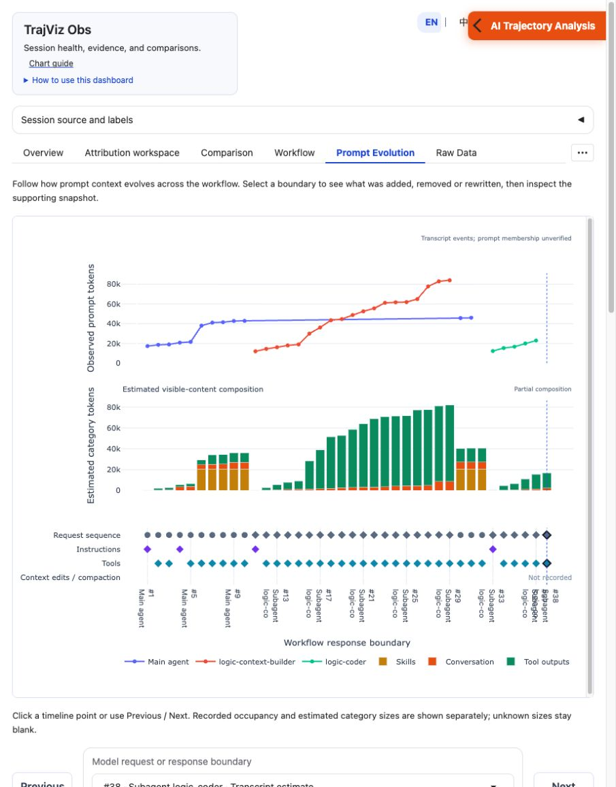
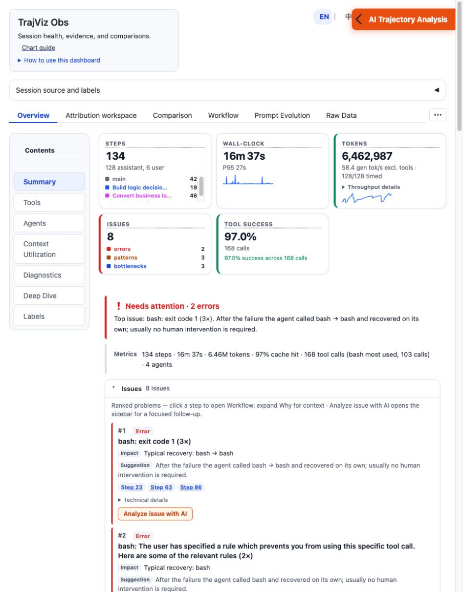

# DevEco Code: Prompt Evolution in a HomeTrans case

TrajViz Obs adds an `obs` tool to DevEco Code 0.2.6. It reads native session history and opens a local dashboard where you can follow the coding agent's runtime and inspect prompt context at each assistant step. The shared analysis engine is TrajViz 0.7.1.

This case ran on 2026-11-26. HomeTrans's planner, coder and reviewer child agents migrated the fixed Simple Progress v1.5 Android source into a fresh HarmonyOS EmptyAbility project. The screenshots are original light-mode captures from that live run.

## Follow prompt context during execution

Prompt Evolution keeps the main agent and subagents on separate curves. Category bars estimate visible transcript content. Recorded occupancy is shown separately from those estimates, and prompt membership remains unverified.

## Inspect one assistant step

At native step 103, the component explorer shows skills, conversation and tool-output candidates with category bases and source references. The preview displays 40 of 67 message components; the recorded JSON retains the complete available data. The verification feedback is absent at step 101 and present at step 103 in the same coordinator context. Its native message ID and text hashes match an independent `chat.message` capture.

The built-in Prompt Evolution view uses estimated transcript context. Opt-in hook snapshots appear separately in Captured components and remain unlinked. Neither reconstructs a complete provider request in this case. The later request-body proxy experiment and proposed assistant-ID host changes are not implemented in this branch.

## Review the coding-agent runtime

The completed case contains 134 native records, 128 assistant boundaries and 168 tool calls across four sessions. It also produced 392 independent component observations. Historical tool errors remain visible even though the final application tests, SDK build and scoped review passed.

The application passed 11 project tests and 28 independent tests of its production model. The DevEco CLI API 26 build and changed-ETS ArkTS/CodeLinter precheck passed, and review found 0 defects. The HAP is unsigned and was not deployed. Device behavior, UI parity, background behavior and restart restoration were outside this validation.

## Try the adapter

Follow the [DevEco installation guide](../README.md), start DevEco in your project and ask its agent to call `obs` with `{ "command": "dashboard" }`. In Prompt Evolution, select a timeline boundary and follow its source references. Use `view prompt_construction --request-id <id>` to inspect an exact ID returned by the view.

Prompt component capture requires the separate launch opt-in in the installation guide. The diagnostic tool makes no model calls; natural-language routing through DevEco may use its configured coding model. Keep private native sessions and prompt captures outside the repository.
