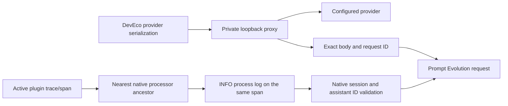
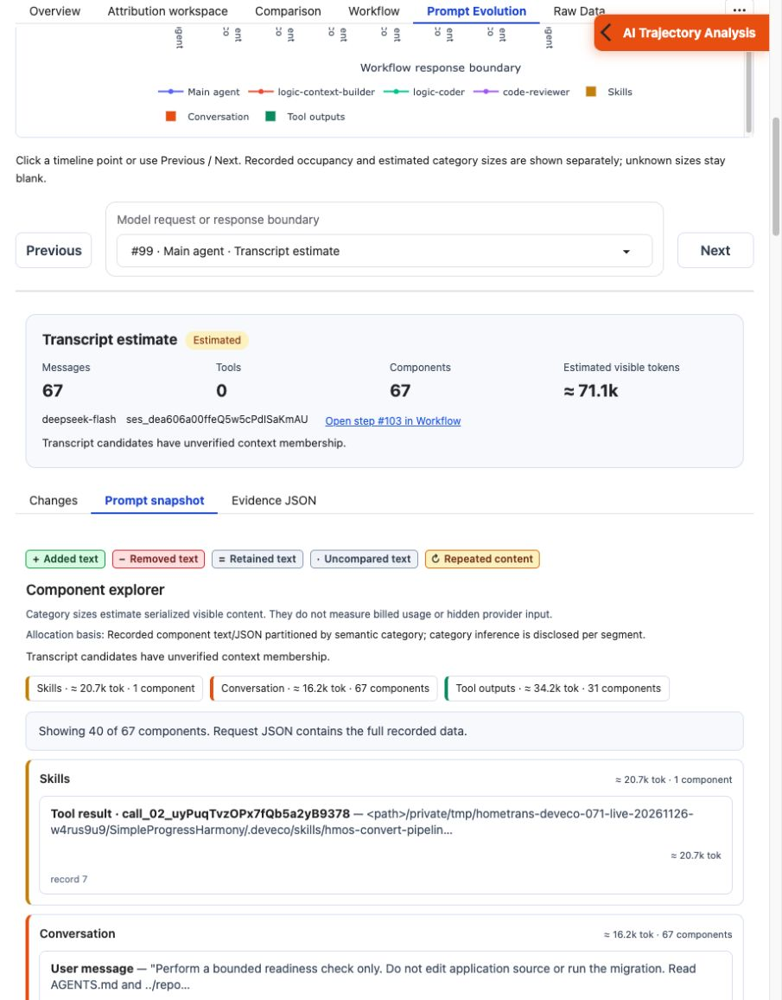
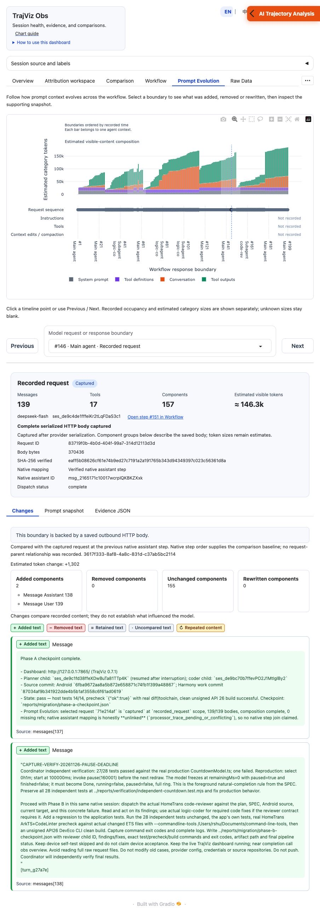
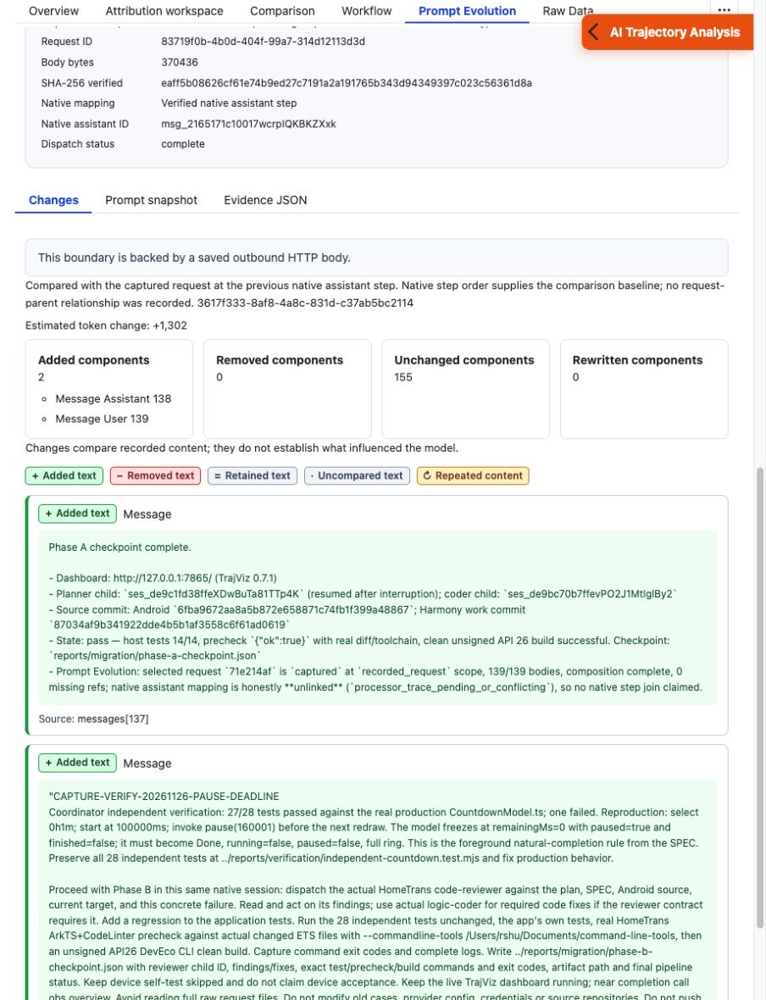
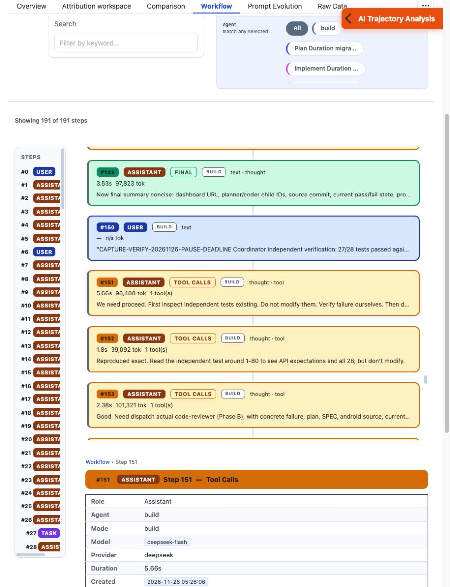

# DevEco Code: Prompt Evolution in a HomeTrans case

TrajViz Obs adds an `obs` tool to DevEco Code 0.2.6. It reads native session history and opens a local dashboard where you can follow the coding agent's runtime and inspect prompt context at each assistant step. The shared analysis engine is TrajViz 0.7.1.

The migration case below ran on 2026-11-26. HomeTrans's planner, coder and reviewer child agents migrated the fixed Simple Progress v1.5 Android source into a fresh HarmonyOS EmptyAbility project. Its light-mode screenshots predate complete HTTP request capture and show estimated transcript context.

## Follow a complete request to its assistant step

The adapter now includes a separate opt-in HTTP capture path for DevEco Code 0.2.6. A local fixed-upstream proxy records the exact body produced by the provider adapter, including the actual messages, tool definitions, and parameters. The original body, SHA-256 digest, and byte count remain private sidecar evidence. Prompt Evolution reads this evidence for the host-selected native session; ordinary trajectory exports remain unchanged.

The plugin obtains its active trace/span through the public OpenTelemetry API. The launcher's local collector retains span ancestry and the native identity from DevEco's INFO `process` log, without retaining general log bodies. The reader follows the exact ancestor chain to `SessionProcessor.process`, then checks the session and assistant message ID against the loaded native record. A body can appear before this proof is complete: its step link stays pending until a refresh finds all three pieces. Compaction requests can link to their native summary assistant when the same proof succeeds; title and auxiliary requests remain visible without an assistant-step link. No timestamp or nearest-message match supplies an identity. To show actual additions and removals, the reader can compare against the sole captured request on the immediately preceding native assistant step. That labeled display baseline carries no request-lineage or causal claim, and is unavailable when earlier retries make it ambiguous.

Use the [complete capture launch command](../README.md#capture-complete-provider-requests), then invoke `obs` with `command: "dashboard"`. Select a request in **Prompt Evolution**, or invoke `view prompt_construction --request-id <id> --json` to inspect its exact serialized body and validated source link. A failed or still-forwarding request can have a complete captured body; dispatch and HTTP status are shown separately. Retries remain distinct physical requests, and assistant aggregate usage is never duplicated across them. Character-based composition sizes remain estimates.

The recorder uses private `0700` directories and `0600` files, with a 16 MiB body cap. It temporarily changes only explicitly selected provider base URLs in the running configuration. Normal upstream HTTPS verification remains enabled; the implementation uses no TLS interception and does not modify the installed DevEco binary. See the [installation guide](../README.md) for the full storage limits and export boundaries.

## Follow prompt context during execution

Prompt Evolution keeps the main agent and subagents on separate curves. Category bars estimate visible transcript content. Recorded occupancy is shown separately from those estimates, and prompt membership remains unverified.

## Inspect one assistant step

At native step 103, the component explorer shows skills, conversation and tool-output candidates with category bases and source references. The preview displays 40 of 67 message components; the recorded JSON retains the complete available data. The verification feedback is absent at step 101 and present at step 103 in the same coordinator context. Its native message ID and text hashes match an independent `chat.message` capture.

In this historical migration run, Prompt Evolution used estimated transcript context. Opt-in hook snapshots appeared separately in Captured components and remained unlinked. These screenshots demonstrate that earlier evidence boundary; the implemented complete-capture path described above requires its own launch opt-in and a new coding run.

## Review the coding-agent runtime

The completed case contains 134 native records, 128 assistant boundaries and 168 tool calls across four sessions. It also produced 392 independent component observations. Historical tool errors remain visible even though the final application tests, SDK build and scoped review passed.

The application passed 11 project tests and 28 independent tests of its production model. The DevEco CLI API 26 build and changed-ETS ArkTS/CodeLinter precheck passed, and review found 0 defects. The HAP is unsigned and was not deployed. Device behavior, UI parity, background behavior and restart restoration were outside this validation.

## Try the adapter

Follow the [DevEco installation guide](../README.md), start DevEco in your project and ask its agent to call `obs` with `{ "command": "dashboard" }`. In Prompt Evolution, select a timeline boundary and follow its source references. Use `view prompt_construction --request-id <id>` to inspect an exact ID returned by the view.

Complete request capture and independent prompt-component capture have separate launch opt-ins in the installation guide. The diagnostic tool makes no model calls; natural-language routing through DevEco may use its configured coding model. Keep private native sessions and prompt captures outside the repository.

## Complete request capture: fresh end-to-end case

A new run used DevEco Code 0.2.6, TrajViz 0.7.1, HomeTrans, and DevEco CLI 1.3.0 to migrate Simple Progress v1.5 into a newly scaffolded API26 HarmonyOS project. It captured **199 complete HTTP bodies across four native sessions**. Every assistant request (198) passed body hash checks and matched its native assistant step through trace ancestry and processor identity logs. The title request stayed unlinked. The native trajectory contains 206 records and 233 tool calls.

Independent checks found a real countdown race: Pause could freeze an expired task at zero. Feedback was absent from the complete request at step149 and present at step151. The body grew from 367,175 to 370,436 bytes, adding two messages; system text and tool definitions were unchanged. The native code-reviewer fixed the production model. The unchanged independent suite then passed 28/28, application tests passed 15/15, actual-SDK ArkTS/CodeLinter prechecks passed, and DevEco CLI produced an unsigned HAP. Device acceptance was not run.

The first collector recorded unnecessary framework spans. Before it reached its storage cap, the case was stopped gracefully, the closed journal was reduced to the verified ownership spans, and the same native planner session resumed. All captured bodies were preserved and all 198 assistant mappings were verified at the final checkpoint.

The [bilingual HTML report](reports/complete-request-capture-20261126.html) includes the request construction path, an actual trace/identity join, an interactive request-size chart, and the feedback comparison. Complete private prompts and credentials are excluded from that report and this repository.

