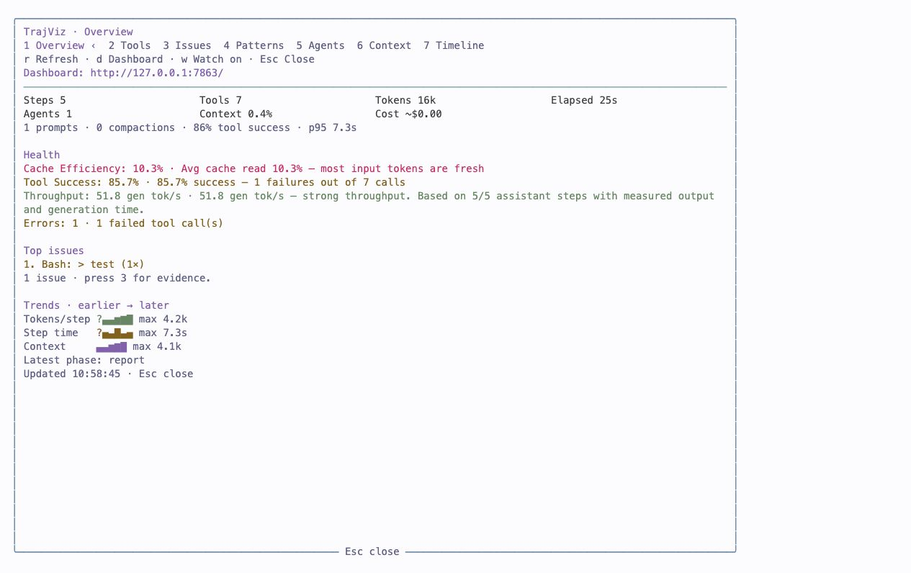

# TrajViz Obs for Pi

Inspect a running Pi session with local diagnostics, colored terminal charts, and the [TrajViz](https://github.com/rshu/TrajViz) browser dashboard. Tested with **Pi 1.5.2** and TrajViz **0.5.1**.

## Install

Install or update [Pi](https://pi.dev/):

```sh
npm install -g --ignore-scripts @earendil-works/pi-coding-agent@1.5.2
```

Install the extension:

```sh
pi install git:github.com/rshu/TrajViz-Obs
```

Restart Pi or run `/reload`. Complete an assistant response, then run:

```text
/obs
/obs pane
/obs dashboard
```

The first diagnostic command installs a private Python runtime. Opening a dashboard adds its dependencies. Initial setup requires network access and either [uv](https://docs.astral.sh/uv/) or Python **3.11+** with `venv` and `pip`. Diagnostics run locally without a model call.

For a local checkout, use `pi install /absolute/path/to/TrajViz-Obs`. Source installs use the repository's Pi manifest and need no build. To update a Git installation, run `pi update git:github.com/rshu/TrajViz-Obs`, then `/reload`.

## Use

`/obs` shows a compact summary above the editor. `/obs pane` opens a scrollable overlay with **Overview, Tools, Issues, Patterns, Agents, Context, and Timeline**. It closes with **Esc**, leaving your conversation in place.

| Task | Command |
| --- | --- |
| Inspect diagnostics | `/obs issues`, `/obs agents`, `/obs context`, `/obs view` |
| Inspect recorded workflow evidence | `/obs attribution` |
| Open the browser dashboard | `/obs dashboard`; stop with `/obs dashboard stop` |
| Export data | `/obs json`, `/obs bundle`, `/obs collect pi session.jsonl` |
| Save offline HTML | `/obs dashboard --html session.html` |
| Compare sessions | `/obs compare <id-or-path>`, `/obs converge` |
| Ask for analysis or fixes | `/obs analyze [question]`, `/obs fixes` |
| Label steps | `/obs label --max-steps 20` |
| List saved sessions | `/obs sessions 20` |
| Check setup | `/obs doctor`, `/obs setup` |
| List every command and option | `/obs help` |

The overlay supports **1–7** or **← →** to switch tabs, **↑ ↓ / Page Up / Page Down** to scroll, **r** to refresh, **d** to open the dashboard, and **w** to toggle watch. Escape also cancels a running Obs command's progress panel. `/obs cancel` cancels an active command through an RPC client.

Watch refreshes the widget and overlay after turns and tree navigation. `/obs watch off` stops automatic refreshes. `/obs statusline off` removes the footer summary. The browser dashboard loads the latest private capture when you press **Load** or reload its page; rerunning `/obs dashboard` also loads the latest capture.

Add `--session <id|prefix|path>` to inspect another session. Imported captures also support `--session-id <id>`. Running `/obs` without a selector returns to the current session. Active-tree navigation and unsaved sessions use Pi's in-memory state, so abandoned branches do not inflate the selected run's metrics. A Pi collection retains the complete tree and active selection. Forks include their inherited branch history; elapsed time covers the displayed steps.

AI analysis, fixes, and labeling use Pi's selected model and authentication by default. They preview their call count and estimated input size; more than four calls require confirmation. Requests can incur model charges. The dashboard's AI settings are separate. See [data and model use](https://github.com/rshu/TrajViz-Obs#data-and-model-use).



## Configure

Optional settings go in `~/.pi/agent/trajviz-obs.json`, or `$PI_CODING_AGENT_DIR/trajviz-obs.json` when using a custom agent directory. Project settings in `.pi/trajviz-obs.json` override them. Run `/reload` after editing these files.

```json
{
  "watch": true,
  "statusline": true,
  "openBrowser": false,
  "dashboardPort": 0,
  "llm": "session",
  "labelMaxSteps": 50
}
```

| Option | Default |
| --- | --- |
| `watch`, `statusline` | `true` |
| `openBrowser` | `false`; open dashboard URLs automatically when enabled |
| `dashboardPort` | `0` for automatic selection |
| `llm` | `session`; use `env` for the shared `ANALYZE_*` / `LABEL_*` provider settings |
| `analysisModel`, `labelModel` | Selected Pi model; optionally set `provider/model` or `session` |
| `labelMaxSteps` | `50` |
| `python`, `trajvizSource`, `cacheRoot` | Automatic Python discovery, `agent-trajviz==0.5.1`, and `~/.cache/trajviz-obs/pi` |

Change the dashboard port during a session with `/obs dashboard port 7863`. Use `auto` for automatic selection or `default` to restore the file setting. `/obs dashboard --port N` overrides it for one launch.

Usage telemetry is off by default. `/obs enable_telemetry` opts in, `/obs disable_telemetry` stops recording and pauses uploads, and `/obs telemetry` checks delivery. Set the collector during a session with `/obs telemetry_destination https://telemetry.example.com`. The choice is separate from Claude Code and OpenCode. See [telemetry configuration and reports](https://github.com/rshu/TrajViz-Obs/blob/main/telemetry/README.md).

## Limits

- Pi's terminal overlay uses Pi's native UI APIs. RPC clients receive command results as notifications. Print and JSON modes do not have a slash-command result UI; use interactive Pi or an RPC client for `/obs`.
- Pi subagents are implemented by extensions. Nested tool records are preserved, but child processes are not presented as confirmed subagents without explicit relationships. A fork is session ancestry.
- Timing uses Pi's native durations when available and recorded timestamps otherwise. Missing evidence appears as unknown. Cost estimates supplied by Pi depend on its configured model pricing.
- Automatic captures are capped at 64 MiB. Export a large native session and inspect it manually when needed. The browser dashboard shows at most 2,000 steps. JSON and bundle exports retain the complete parsed trajectory. Keep exports private when they contain project data.
- Real-session validation covers macOS. Linux and Windows need platform-specific runtime testing.

## Development

```sh
cd pi
bun install --frozen-lockfile
bun run build
bun run typecheck
bun test
```

The package build bundles the adapter and shared Node helpers, copies the Python bridge, and keeps Pi's host libraries external. `npm pack` produces a standalone package without development files. Tests use the installed bridge environment when available; set `TRAJVIZ_OBS_TEST_PYTHON` to choose its interpreter. Test artifacts stay outside the repository.
